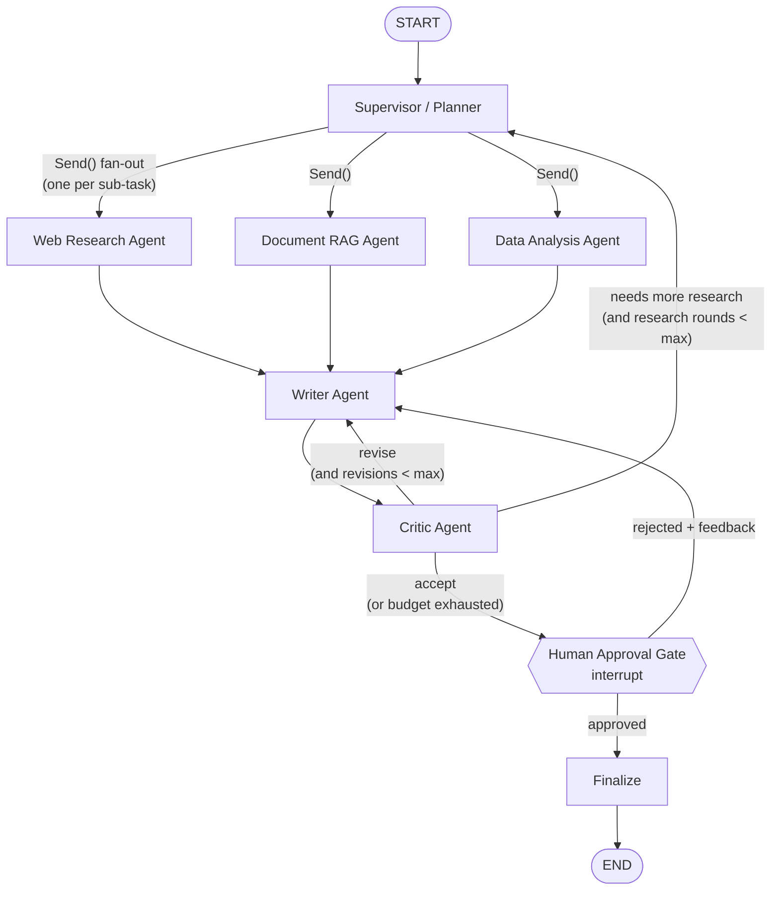

# Multi-Agent Analyst

A self-contained multi-agent research system built with **LangGraph**. A supervisor agent takes a complex research question, breaks it into sub-tasks, and hands them to specialist agents: web research, private-document RAG, and data analysis. A writer agent turns their findings into a cited report. A critic agent reviews the report and can send it back for revision. A human approves the report before it is final.

It runs on **Google Gemini's free tier** and uses **local embeddings**, so it costs nothing to run.

> Status: ✅ all 15 roadmap steps built (see [Build roadmap](#build-roadmap)).

## Quickstart

```bash
uv sync                          # create .venv and install deps
cp .env.example .env             # then set GOOGLE_API_KEY (free: https://aistudio.google.com/apikey)
uv run python -m analyst.llm     # live check of both model tiers: should print "pong" twice

uv run python scripts/make_sample_data.py      # synthetic company PDFs + sales CSV
uv run python -m analyst.rag.index             # chunk + embed the PDFs into data/index/
uv run python -m analyst.data.load              # load the sales CSV into SQLite (data/analyst.db)
uv run python -m analyst.rag.search "key risks in 2024"   # inspect retrieval (no LLM)

uv run pytest                    # offline tests (fake LLM, no API calls, no model download)
uv run pytest -m live            # opt-in tests that call Gemini
uv run pytest -m model           # opt-in tests that load the real embedding model
```

### Sample data

**Kestrel Ridge Outdoor Co.** is a fictional outdoor-gear maker, with 3 annual reports (2022–2024) and 288 rows of quarterly sales (quarter × region × product line × channel). Revenue dips in 2023 because of wholesale destocking ($412.6M → $393.1M) and reaches a record $466.7M in 2024. Every figure in the PDFs is computed from the CSV, so the two sources never disagree. Each source holds facts the other lacks (risks and the recall are only in the PDFs, quarterly detail only in the CSV), so a question like *"Summarize the company's revenue trend and key risks, with sources"* needs all three specialists.

**Free-tier quota:** Gemini's free tier limits requests *per model per day* (it was 20/day for `gemini-3.8-flash` on this project's key). A full multi-agent run makes roughly 10–15 LLM calls, so check your limits at https://ai.dev/rate-limit.

Gemini model names change often. If the default `GEMINI_MODEL` returns a 404, list the models your key can use:

```bash
uv run python -c "from google import genai; [print(m.name) for m in genai.Client().models.list() if 'flash' in m.name]"
```

## Running with Docker

The image is multi-stage. A builder installs the locked dependencies with uv, using **CPU-only torch**, and downloads the embedding model. The slim runtime stage gets only the virtualenv, the model and the source. It runs as a **non-root** user with `HF_HUB_OFFLINE=1`, so the model loads from the image and the container never calls Hugging Face. No `.env` is baked in. `data/` is a **bind mount**, so the index, the database and the paused-run checkpoints persist on the host.

```bash
# 1. Your key: in your shell (export GOOGLE_API_KEY=...) or in .env. Compose reads both.
cp .env.example .env              # then set GOOGLE_API_KEY

# 2. Build the image and prepare data/ (sample data if data/docs is empty -> SQLite -> index).
docker compose build
docker compose run --rm indexer   # one-off; the "tools" profile keeps it out of `up`

# 3. Start the API (bound to 127.0.0.1:8000 only: there is no authentication).
docker compose up -d
docker compose ps                 # STATUS shows "healthy" once /health answers
curl http://127.0.0.1:8000/health # {"status":"ok","active_runs":0}
```

Run a question through the API (interactive docs at http://127.0.0.1:8000/docs):

```bash
# Start a run: returns {"thread_id": "...", "status": "running"} immediately.
curl -s -X POST http://127.0.0.1:8000/runs \
     -H "Content-Type: application/json" \
     -d '{"question": "Summarize the company'\''s revenue trend and key risks, with sources"}'

# Poll until "status" is "awaiting_review" (a few minutes on the free tier).
# "review.preview" is the draft as the reader will see it.
curl -s http://127.0.0.1:8000/runs/<thread_id>

# Approve (or reject: {"approved": false, "feedback": "Add more on tariffs"}).
curl -s -X POST http://127.0.0.1:8000/runs/<thread_id>/review \
     -H "Content-Type: application/json" -d '{"approved": true}'

# Poll again until "status" is "done": the final report is in "report".
curl -s http://127.0.0.1:8000/runs/<thread_id>
```

Or review in the terminal with the CLI inside the container. It shares the same checkpoint database: `docker compose run --rm -it api python scripts/review.py "your question"`.

Notes: `docker compose logs -f api` shows agent progress. Restarting the container (`docker compose restart api`) keeps every run, because state lives in `data/checkpoints.db`. If you change `EMBEDDING_MODEL`, rebuild with `--build-arg EMBEDDING_MODEL=...` and re-run the indexer, since the container is offline. On a Linux host, `data/` must be writable by UID 1000, the container's user.

---

## 1. Architecture at a glance



The flow, step by step:

1. The **Supervisor** reads the question and writes a **plan**: a list of sub-tasks, each assigned to one specialist.
2. LangGraph's `Send` API **fans out** the sub-tasks so the specialists run **in parallel**. Each specialist writes its findings and sources into shared state.
3. When every branch has finished (the LangGraph superstep barrier), the **Writer** turns the findings into a report with citations.
4. The **Critic** scores the draft against a rubric and picks one of three outcomes:
   - **accept**: go on to the human gate.
   - **revise**: send the draft back to the writer with specific feedback.
   - **research**: there is a real gap in the evidence, so go back to the supervisor for another round of targeted sub-tasks.
5. The **Human Gate** pauses the graph with `interrupt()`. Because a checkpointer persists the state, the run can wait for hours. The human approves, or rejects and gives feedback, which goes back to the writer.
6. **Finalize** renders the approved report and its numbered bibliography.

Hard budgets (`MAX_REVISIONS`, `MAX_RESEARCH_ROUNDS`) guarantee the loops end. That matters on a free-tier rate limit.

---

## 2. The agents

| Agent | Role | Tools | Output into state |
|---|---|---|---|
| **Supervisor / Planner** | Breaks the question into 2–6 self-contained sub-tasks and assigns each to `web`, `rag`, or `data` (structured output). Its prompt includes a **resource catalog** built from what actually exists (indexed PDFs, database tables and columns), and specialists whose data is missing are marked unavailable. Code validates the plan (drops unavailable specialists and duplicates, caps the size). On a **research round** it receives the critic's gaps plus the findings so far and plans only 1–3 gap sub-tasks; earlier findings are kept by the append reducer. | None (LLM with structured output) | `plan`, `research_rounds` |
| **Web Research** | Answers one sub-task from the live web. The LLM writes 1–2 search queries; DuckDuckGo results are deduplicated; the LLM picks the pages worth reading; pages are fetched **in parallel through a guarded fetcher**. Failed pages are **backfilled** from the remaining results, skipping hosts that already refused us. The answer uses only the **most relevant passages** of each page (chunker + BM25 reused from RAG) and cites URLs. | `web_search` (DuckDuckGo via `ddgs`, no key), `web_fetch` (httpx + stdlib HTML-to-text) | `findings`, `sources` (URLs) |
| **Document RAG** | Answers one sub-task from the private PDFs in `data/docs/`. The LLM rewrites the sub-task into 1–3 search queries and, if the sub-task names a year, a **year filter**. **Hybrid search** (BM25 + vectors, fused with RRF) over **our own vector store** retrieves chunks, and the LLM answers only from them, citing pages. | `Retriever.retrieve(queries, k, filters)` | `findings`, `sources` (file + page) |
| **Data Analysis** | Answers quantitative sub-tasks over the local sales dataset. It reads a **profiled schema** (exact category values, numeric ranges), writes 1–3 **read-only SQL** queries that do all the arithmetic (growth, shares, $M), runs them through the guarded SQL tool, **repairs failed queries** using the error message (max 2 attempts), and interprets only the result tables. | `run_sql` (4 layers: SELECT-only validation, read-only connection, SQLite authorizer, row cap + timeout) | `findings`, `sources` (the SQL query + its result) |
| **Writer** | Synthesizes all findings into a structured Markdown report (title, Summary, theme sections, Limitations) on the **strong** tier. It sees sources as short labels `[S1]…`, which are resolved back to stable source ids before the draft is stored, so invented labels are dropped and the draft only cites ids in `sources`. On a **revision** it gets the previous draft plus numbered feedback points: human feedback first (marked as highest priority), then the critic's, plus any findings from a research round. If the model fails, it falls back to a cited findings-only report, or keeps the previous draft. | None | `draft`, `revision_count` |
| **Critic** | **1. Deterministic gate:** every factual sentence must cite a source, and every cited id must exist in `sources` (headings, intro lines ending in ':', and the Limitations section are exempt). If it fails, the verdict is `revise` with the offending sentences quoted, and **no LLM call** is made. **2. LLM judge** (strong tier, with the fast fallback): scores groundedness, coverage and clarity (1–5), then gives a verdict (accept / revise / research), a feedback list, and missing topics. Code keeps the verdict consistent (research without topics becomes revise; accept with a score below 3 becomes revise). **3. Budgets:** with no revisions left, revise becomes accept; with no research rounds left, research becomes a revise that states the gaps under Limitations; with both spent, the judge isn't called. Open feedback is kept for the human. | Deterministic citation checker | `critiques` |
| **Human Gate** | Pauses the run with `interrupt()` and hands the caller the draft, a reader-facing preview (numbered citations + Sources), and the latest critique. Resumed with `"approve"` or rejection text (or `{"approved", "feedback"}`); rejection feedback goes first in the writer's next prompt. `HUMAN_REVIEW=false` auto-approves (batch runs, evals). | `interrupt()` + SQLite checkpointer | `human_feedback`, `approved` |
| **Finalize** | **Deterministic, no LLM.** Renumbers citations to `[1]…[n]` in order of first appearance (numbers sorted within a group), drops any id not in `sources` (the last defense against invented citations), and appends a **Sources** section: label, type (rag/data/web), and a one-line description (page reference, URL, or the SQL itself). | None | `final_report` |

**Design choice: why the data agent writes SQL instead of executing Python.** Running arbitrary LLM-generated Python needs a real sandbox. Read-only SQL against a local SQLite file is enough for "run numbers over a dataset", it is easy to restrict (SELECT only, read-only connection, row cap), and it is easy to trace. A sandboxed Python tool could be added later as an extension.

---

## 3. Shared state

Every node reads from and writes to one typed state object. Fields that parallel branches write to use **reducers**, so concurrent updates merge instead of overwriting each other.

```python
class Subtask(TypedDict):
    id: str
    agent: Literal["web", "rag", "data"]
    instruction: str


class Source(TypedDict):
    id: str  # stable content hash, e.g. "web:3f9a1c" / "doc:annual_report.pdf#p4" / "data:8b2e"
    kind: Literal["web", "doc", "data"]
    title: str
    locator: str  # URL, file+page, or the SQL query
    snippet: str  # the evidence text the claim rests on


class Finding(TypedDict):
    subtask_id: str
    agent: str
    summary: str  # the agent's answer to its sub-task, with inline [source_id] cites
    source_ids: list[str]


class Critique(TypedDict):
    scores: dict[str, int]  # groundedness, coverage, citations, clarity (1–5)
    verdict: Literal["accept", "revise", "research"]
    feedback: str
    missing_topics: list[str]  # used by the supervisor on a "research" loop


class AnalystState(TypedDict):
    question: str
    plan: list[Subtask]
    findings: Annotated[list[Finding], operator.add]  # reducer: append
    sources: Annotated[dict[str, Source], merge_dicts]  # reducer: dict merge
    draft: str
    critiques: Annotated[list[Critique], operator.add]
    revision_count: int
    research_rounds: int
    human_feedback: str | None
    approved: bool
    final_report: str
```

Why the design looks like this:

- **Reducers (`operator.add`, `merge_dicts`).** Three specialists can finish in the same superstep. Without reducers, the last writer would win and the other findings would be lost.
- **Content-hash source IDs.** Parallel agents could both create "source 1". Hashing the locator gives every source a stable ID that can't collide. Finalize renumbers them to `[1]…[n]` for display.
- **`Send` payloads.** Each specialist receives only its own `Subtask` (plus the question), not the whole state. That keeps prompts small and avoids distracting the agent.
- **History lists (`critiques`).** Keeping every critique, not just the latest, lets the writer see what was already asked for. It also makes the reflection loop easy to inspect in traces and evals.

---

## 4. The reflection / critic loop

```
writer ──► critic ──► verdict?
  ▲                    ├── accept  ───────────────► human gate
  │                    ├── revise   (rev < MAX) ──► writer   (feedback attached)
  │                    └── research (rr < MAX)  ──► supervisor (plans only the missing topics)
  └──────────────────────────────────────────────────────────┘
```

- The critic uses **structured output** (a Pydantic schema), so routing is a plain conditional edge on `verdict`. No fragile string parsing is needed.
- **A deterministic pre-check runs before the LLM judge.** Any cited ID that isn't in `sources`, or a report with no citations, forces `revise`. A cheap rule catches hallucinated citations reliably. An LLM judge alone would not.
- **The loop has budgets:** `MAX_REVISIONS=2`, `MAX_RESEARCH_ROUNDS=1` by default. When a budget runs out, the draft moves on to the human gate with the critique attached, so the human sees the critic's open concerns.
- Separating **"revise" (writing problem)** from **"research" (evidence problem)** is the key design point. Rewriting can't fix missing facts, and more research can't fix a badly organized draft.

---

## 5. Human-in-the-loop gate

- It is implemented with LangGraph's `interrupt()` inside the `human_gate` node, together with a **checkpointer** (SQLite). The graph state is saved under a `thread_id`, and execution stops.
- The run resumes with `Command(resume="approve")` or `Command(resume="<feedback text>")`. The API sends the structured form `{"approved": bool, "feedback": str | None}`:
  - **approved**: go to `finalize` and then `END`.
  - **rejected**: the feedback is stored in `human_feedback`, and the graph goes back to the writer. Human feedback takes priority over critic feedback in the writer prompt. Human rejection has no budget: the person decides when to stop.
- On resume LangGraph re-runs the gate node **from the top**, and `interrupt()` returns the resume value. Code before `interrupt()` must therefore be deterministic and side-effect free (here it only builds the payload).
- `build_graph` refuses to compile with review on and no checkpointer, so a misconfiguration fails at startup instead of after all the LLM calls.
- CLI: `uv run python scripts/review.py "<question>"` runs to the gate, prints the draft and critique, and reads `approve` or feedback from stdin. Ctrl+D / Ctrl+Z leaves the run paused; `--resume <thread_id>` continues it later, even from a new process. The same flow is exposed through the API (see below).
- Interview angle: this is the same pattern used for approval of risky tool calls. The pause is durable, it survives a process restart, and the resume value is auditable.

---

## 6. Platform pieces

| Concern | Approach |
|---|---|
| **LLM** | `LLM_PROVIDER=gemini` through `langchain-google-genai`, behind a small `llm.py` factory (plus a scripted `fake` provider for offline tests). **Per-step model routing:** call sites ask for a tier, not a model. `fast` (`GEMINI_FAST_MODEL`, default `gemini-3.5-flash-lite`) handles light steps: search-query planning and page selection. `strong` (`GEMINI_MODEL`, default `gemini-3.8-flash`) handles supervisor planning, SQL, grounded answers, writing and critique. Free-tier quotas are **per model per day**, so two models roughly double the daily budget. Each model has its own client-side rate limiter, shared by all its instances. **Strong → fast fallback:** a quota (429) or overload (503) error on the strong model retries the same call, including structured-output calls, on the fast model (`LLM_FALLBACK_TO_FAST`). |
| **Embeddings** | `sentence-transformers` (`all-MiniLM-L6-v2`, 384-dim), run locally on CPU at no cost. |
| **Vector store** | **Written from scratch**: NumPy matrix of L2-normalized embeddings, cosine similarity via a dot product, top-k with `argpartition`, persisted as `.npy` + `.jsonl` metadata. No vector DB dependency. Doing it by hand shows you understand what a vector DB does. |
| **Hybrid search** | **BM25 written from scratch** (inverted index, idf, length normalization, plural stemming) next to cosine search, fused with **Reciprocal Rank Fusion** (k=60). Vectors find meaning (\"sales increased\" ≈ \"revenue grew\"); BM25 finds exact tokens like years and figures, which small embedders blur. An exact **metadata filter** (`{\"year\": 2024}`) is applied before ranking. |
| **Web safety** | The fetcher **refuses non-public IPs (SSRF guard: cloud metadata, localhost, private ranges)**, follows redirects itself so every hop is re-checked, honours **robots.txt** (RFC 9309), accepts only HTML/text, and caps download bytes, extracted characters and time. Page text is treated as untrusted data in prompts. The test suite **blocks real network access**, so offline tests can't silently depend on the internet. |
| **Chunking** | Our own recursive splitter: paragraphs, then lines, sentences, words, and characters, with a target size and overlap cut at sentence boundaries. The loader strips repeated headers and footers and rejoins wrapped lines. Chunks never cross a page, so every citation has an exact page. A **contextual header** (document title + page) is embedded with each chunk, so year-specific pages stay distinguishable. |
| **Tracing** | **Langfuse Cloud** (free tier). `tracing.py` builds a LangChain `CallbackHandler` and `graph.run_config()` puts it in the run's `RunnableConfig`, the **only** injection point: LangChain hands a run's callbacks down to every node and every LLM call inside it, including the parallel `Send` branches, so no agent knows about tracing. One trace per run, **named after the question**, **tagged with the thread id**, with the thread id as the **session**, so a run paused at the human gate shows its before-pause and after-resume traces together. Nested spans per node and LLM call, with token usage. It is a no-op unless both `LANGFUSE_PUBLIC_KEY` and `LANGFUSE_SECRET_KEY` are set. |
| **Evals** | `evals/` harness (see below). |
| **API** | **FastAPI** (`src/analyst/api.py`, started by `scripts/serve.py`): `POST /runs` starts a run and returns its `thread_id` at once (202) · `GET /runs/{thread_id}` returns the status (`running` / `awaiting_review` / `done`, or `failed`), with the review payload (draft, preview, critique) when awaiting review and the report when done · `POST /runs/{thread_id}/review` resumes with `{"approved": bool, "feedback": str?}` (409 if the run isn't awaiting review) · `GET /health`. Runs execute in **background threads** (capped by `API_MAX_CONCURRENT_RUNS`), so requests answer immediately and the client polls. Status is read from the **SQLite checkpoint**, not memory: after an API restart a paused run is still awaiting review, and a run cut off mid-way continues from its last checkpoint when it is next polled. |
| **Docker** | Multi-stage `Dockerfile`: a uv builder stage (locked deps, CPU-only torch, embedding model pre-downloaded) and a slim, non-root runtime with `HF_HUB_OFFLINE=1`. No `.env` in the image (`.dockerignore`). `docker-compose.yml` has an `api` service (port 8000 on localhost, `data/` bind-mounted, `GOOGLE_API_KEY` from the host) and a one-off `indexer` service (profile `tools`). See [Running with Docker](#running-with-docker). |

### Eval harness

`evals/questions.yaml` holds 8 factual questions about Kestrel Ridge (yearly revenue, growth, the 2023 decline and its causes, product lines, 2024 risks, supplier concentration, DTC share, Asia-Pacific growth). Each has regex ground truths taken from the deterministic sample-data generator, and a test fails if the generator and the questions drift apart. `uv run python evals/run_evals.py` runs every question through the full pipeline (human review off) and scores the result:

| Metric | How it is computed |
|---|---|
| `answer_hit` | Every expected regex appears in the final report body (not in the Sources list) |
| `citation_coverage` | Share of factual sentences in the draft that cite a source, using the critic's citation checker |
| `no_invented_citations` | Every cited id in the draft exists in `sources`, and every `[n]` in the final report has a Sources entry |
| Also recorded | Revisions, research rounds, critic verdicts, sources cited / collected, duration, the full report |

**Scoring is deterministic, with no LLM-as-judge:** the same report always gets the same score, scoring costs no quota (so it can run in CI), and a failure names the exact missing pattern. The pipeline itself still calls the LLM. Results go to `evals/results/<timestamp>.json` with the config that produced them, plus a summary table. `--min-answer-hit` / `--min-citation-coverage` make the script exit 1 below a threshold, for CI gating.

---

## 7. Proposed folder structure

```
multi-agent-analyst/
├── README.md
├── pyproject.toml              # deps + tooling (ruff, pytest)
├── .env.example                # GOOGLE_API_KEY, LLM_PROVIDER, GEMINI_MODEL, LANGFUSE_*, budgets
├── Dockerfile                  # multi-stage: uv builder -> slim non-root runtime
├── docker-compose.yml          # api service + one-off indexer (profile "tools")
├── .dockerignore               # keeps .env, data/, .venv and tests out of the image
│
├── data/
│   ├── docs/                   # sample PDFs for the RAG agent
│   ├── datasets/               # sample CSV(s) → loaded into analyst.db
│   └── index/                  # persisted vector store (generated, git-ignored)
│
├── src/analyst/
│   ├── config.py               # pydantic-settings: env vars, budgets, paths
│   ├── llm.py                  # provider factory (gemini | fake) + rate limiter
│   ├── data/
│   │   └── load.py             # CLI: CSVs → typed SQLite tables (atomic rebuild)
│   ├── state.py                # AnalystState, Subtask, Source, Finding, Critique, reducers
│   ├── graph.py                # builds & compiles the StateGraph (+ checkpointer)
│   ├── prompts.py              # all system prompts in one place
│   │
│   ├── agents/
│   │   ├── supervisor.py       # planning + Send fan-out routing
│   │   ├── web_research.py
│   │   ├── rag.py
│   │   ├── data_analyst.py         # schema → SQL → guarded run (+ self-repair) → cited answer
│   │   ├── citations.py        # [D1]/[Q1] labels → stable source ids, drops invented ones
│   │   ├── common.py           # short_error(): length-capped error text for ERROR findings
│   │   ├── writer.py
│   │   ├── critic.py           # deterministic citation check + LLM judge
│   │   ├── human_gate.py       # interrupt()
│   │   └── finalize.py         # renumber citations, bibliography
│   │
│   ├── tools/
│   │   ├── web_search.py       # DuckDuckGo wrapper (swappable search function)
│   │   ├── web_fetch.py        # SSRF guard, robots.txt, redirects, size/time caps
│   │   ├── html_text.py        # stdlib HTML → main text (drops nav/scripts, prefers <article>)
│   │   └── sql.py              # validation + read-only conn + authorizer + row cap + timeout
│   │
│   ├── rag/
│   │   ├── loader.py           # PDF → pages (pypdf)
│   │   ├── chunker.py          # recursive splitter with overlap
│   │   ├── embedder.py         # sentence-transformers wrapper
│   │   ├── vector_store.py     # NumPy cosine-similarity store
│   │   ├── bm25.py             # BM25 keyword scoring (from scratch)
│   │   ├── retriever.py        # hybrid search: vector + BM25 fused with RRF, metadata filters
│   │   ├── index.py            # CLI: build the index from data/docs
│   │   └── search.py           # CLI: inspect retrieval results for a query
│   │
│   ├── tracing.py              # Langfuse callback via the run config (no-op if unconfigured)
│   └── api.py                  # FastAPI app: start / poll / review runs (background threads)
│
├── evals/
│   ├── questions.yaml          # questions + regex ground truths (from the generator)
│   ├── run_evals.py            # run the pipeline, score deterministically, write JSON
│   └── results/                # timestamped results (git-ignored)
│
├── scripts/
│   ├── make_sample_data.py     # generates the sample CSV/PDFs so the repo is reproducible
│   ├── review.py               # CLI: run a question, approve/reject at the human gate, --resume
│   ├── serve.py                # starts the API with uvicorn
│   └── build_index.sh          # indexer: sample data if missing -> SQLite -> vector index
│
└── tests/                      # unit tests (fake LLM) + graph routing tests
```

---

## Build roadmap

Each step is small, runnable, and explained before moving on.

1. ✅ **Architecture README** (this file)
2. ✅ Project skeleton: `pyproject.toml`, `config.py`, `.env.example`, `llm.py` (Gemini + fake), a smoke test
3. ✅ Shared state + an **empty graph** with stub nodes, to show routing, `Send` fan-out, and reducers working
4. ✅ RAG from scratch: sample data generator, loader → chunker → embedder → vector store → index CLI (+ retrieval tests)
5. ✅ RAG agent node: hybrid search (BM25 + vectors, RRF), year filter, query rewriting, grounded cited answers
6. ✅ Data layer + data-analysis agent (SQLite loader, 4-layer read-only SQL tool, self-repairing SQL agent)
7. ✅ Web tools + web-research agent (DuckDuckGo, guarded fetcher, passage selection, backfill)
8. ✅ Supervisor planner (structured output, resource catalog, gap-filling research rounds) + per-step model routing
9. ✅ Writer agent (cited report, revisions with human/critic feedback) + deterministic finalize (renumbering, bibliography)
10. ✅ Critic + reflection loop (deterministic citation gate, LLM judge, budget enforcement) + strong→fast fallback
11. ✅ Human-in-the-loop gate (`interrupt()`) + SQLite checkpointer + review CLI (`scripts/review.py`)
12. ✅ Langfuse tracing (one callback injected through the run config; trace per run named after the question, tagged with the thread id)
13. ✅ FastAPI service (start / poll / review, background runs, restart-safe via the checkpointer)
14. ✅ Eval harness (8 ground-truth questions, deterministic scoring: answer hit, citation coverage, no invented citations)
15. ✅ Docker + docker-compose (multi-stage uv build, CPU torch, offline model, non-root; api + indexer services)
