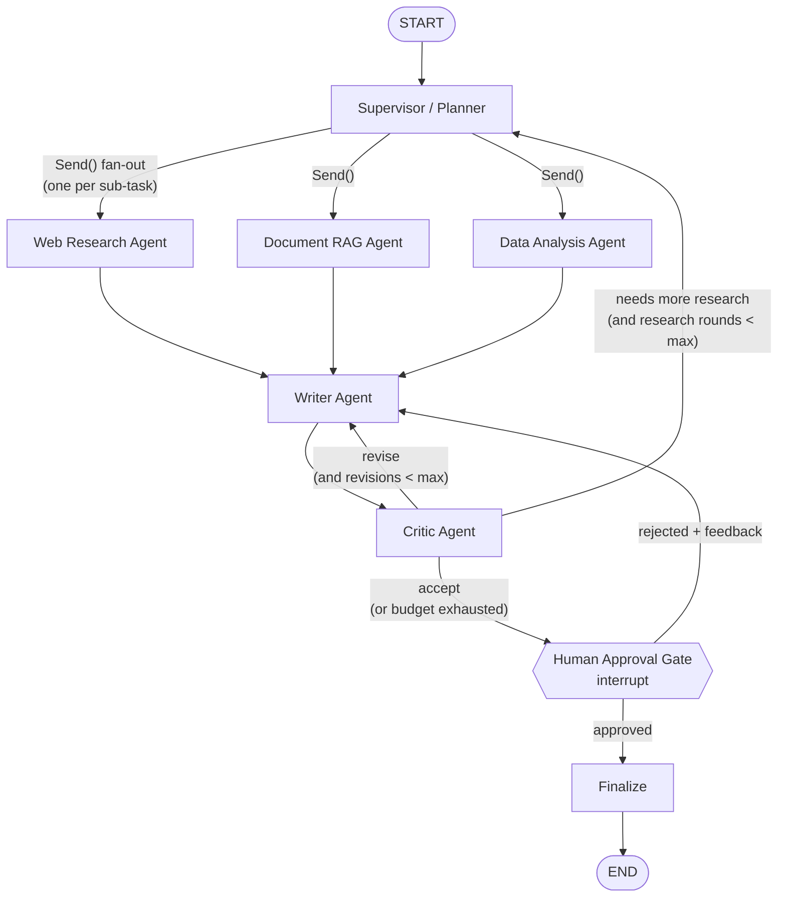

# Multi-Agent Analyst

A self-contained multi-agent research system built with **LangGraph**. A supervisor agent takes a complex research question, breaks it into sub-tasks, and hands them to specialist agents: web research, document RAG over real SEC 10-K filings, and SQL analysis of their XBRL financials. A writer agent turns their findings into a cited report. A critic agent reviews the report and can send it back for revision. A human approves the report before it is final.

It runs on **Google Gemini's free tier** and uses **local embeddings**, so it costs nothing to run.

> Status: ✅ all roadmap steps built (see [Build roadmap](#build-roadmap)).

## Why this beats a single LLM call

Measured, not claimed. `evals/compare.py` scores the full pipeline against a strong one-shot baseline — a single Gemini call given the *same* top-10 retrieved passages the RAG agent uses — on the same questions and the same deterministic scorer:

| Method | Answer hit | Citation coverage | LLM calls/q |
|---|---|---|---|
| One-shot RAG baseline | 57% | 75% | 1.9 |
| **Multi-agent pipeline** | **86%** | **100%** | 10.1 |

7 questions, same model on both sides (partly on the fast fallback model under quota). The gap is on questions where the answer must be **computed** or pulled **without cross-company confusion** — e.g. NVIDIA's year-over-year growth the baseline couldn't derive from text, and Microsoft's net income, where the baseline's retrieved chunks confused Microsoft with Walmart and it gave up. On simple lookups and qualitative questions the two tie, so the pipeline earns its cost on the hard questions. [Full per-question table and honest analysis below.](#does-the-agentic-design-actually-help)

## Quickstart

```bash
uv sync                          # create .venv and install deps
cp .env.example .env             # then set GOOGLE_API_KEY (free: https://aistudio.google.com/apikey)
uv run python -m analyst.llm     # live check of both model tiers: should print "pong" twice

uv run python scripts/fetch_edgar.py            # pinned 10-Ks + XBRL financials from SEC (~3 min)
uv run python -m analyst.data.load              # financials.csv -> SQLite (data/analyst.db)
uv run python -m analyst.rag.index             # segment, chunk + embed the 10-Ks (~10 min on CPU)
uv run python -m analyst.rag.search "Apple supply chain risks" --year 2024   # inspect retrieval

uv run pytest                    # offline tests (fake LLM, synthetic fixture, no network)
uv run pytest -m live            # opt-in tests that call Gemini
uv run pytest -m model           # opt-in tests that load the real embedding model
```

## Data (SEC EDGAR)

The corpus is real and public: **36 annual reports (Form 10-K) of 12 well-known US companies**, three fiscal years each, straight from SEC EDGAR. The documents feed the RAG agent; the financial statements' XBRL facts feed the SQL agent.

| | |
|---|---|
| Companies | Apple, Microsoft, NVIDIA, Amazon, Alphabet, Meta, Tesla, Walmart, Coca-Cola, Johnson & Johnson, Procter & Gamble, Nike |
| Filings | 36 10-Ks, fiscal years 2023–2026 (each company's three latest as of pinning) |
| Indexed text | Items 1 (Business), 1A (Risk Factors), 3 (Legal Proceedings), 7 (MD&A), 7A (Market Risk): 180 sections, ~12,200 chunks |
| SQL | `financials`: 384 rows, 12 metrics (revenue, gross profit, operating income, net income, R&D, diluted EPS, operating cash flow, capex, total assets, total liabilities, equity, cash) |

**Fetched, not committed.** Only [`data/corpus/manifest.yaml`](data/corpus/manifest.yaml) is in git. It pins every filing by its **accession number**, the SEC's id for one immutable filing, so the corpus, the index and the eval answers are identical on every machine and never drift the way "the latest 10-K" would. `scripts/fetch_edgar.py` downloads exactly those filings (~115 MB of HTML plus ~45 MB of XBRL facts) into the git-ignored `data/docs/` and `data/datasets/`:

- `data/docs/<TICKER>_<FY>.html`: the primary 10-K document as filed, plus a `.json` sidecar (company, fiscal year, accession, URL) that the loader reads;
- `data/datasets/financials.csv`: one row per company, fiscal year and metric, taken from the XBRL *company facts* the SEC publishes. Each value is the one **the pinned filing itself reported** for its own fiscal year: not the prior-year comparatives a 10-K also contains, not a quarter, not a later restatement. The `concept` and `accession` columns say exactly where each number comes from.

**`SEC_USER_AGENT` is required by SEC's fair-access policy:** every request must name you and a contact email, or SEC answers 403. Set it in your shell or in `.env` (`SEC_USER_AGENT=Jane Doe jane@example.com`); it defaults to the maintainer's. The script throttles itself to ~2 requests per second (SEC allows 10), stops with a clear message on 403/429 instead of retrying into a longer block, and is **resumable**: files already downloaded are skipped, and writes are atomic, so an interrupted run leaves nothing half-written. `--only AAPL MSFT` fetches some companies; `--pin <TICKER ...> --years 3` re-pins the latest 10-Ks of those tickers into the manifest (review the diff, then fetch).

**Why only Items 1, 1A, 3, 7 and 7A are indexed.** They are the narrative: what the company does, its risks, its legal exposure and management's own explanation of the numbers. Item 8 (the financial statements) is mostly tables, which flatten into number soup that embeds poorly, and the SQL agent already has those figures exactly from XBRL. Leaving it out also halves the index (Item 8 alone would add ~4.4 M characters to the ~7 M indexed) and the embedding time. Add it with `EDGAR_ITEMS=1,1A,3,7,7A,8` and re-index.

**How a 10-K becomes sections** (`rag/edgar.py`): the visible text is extracted with the standard library's HTML parser, dropping the hidden inline-XBRL block (`ix:header`, `display:none`) and re-gluing table cells (`$` | `391,035` → `$391,035`); page numbers and running headers are found by counting lines across printed page breaks, as for PDFs. Each Item heading appears at least twice, in the table of contents and at the Item itself, so the occurrence followed by the most text wins. Consecutive headings of the same Item (Microsoft prints "Item 1A" on every page) continue the Item instead of splitting it. Chevron was replaced by Procter & Gamble during pinning because Chevron puts its MD&A and financial statements in an appendix after Item 15, outside the Item structure.

**Citation format.** A document source is a **passage**: one chunk, or adjacent chunks of the same Item joined back together (their overlap printed once). Its title names the company, fiscal year and Item, and its locator names the file, the Item and the chunk span:

```
title    Apple Inc. (AAPL) 10-K FY 2024, Item 1A. Risk Factors
locator  AAPL_2024.html#item-1a/c3-4
Sources  3. **Apple Inc. (AAPL) 10-K FY 2024, Item 1A. Risk Factors** (rag: document) - AAPL_2024.html, Item 1A, chunks 3-4
```

The source **id** is still the content hash of the locator (`rag:` + 8 hex chars), so citations stay stable across runs and revisions, and finalize's renumbering to `[1]…[n]` is unchanged. Only the human-readable descriptor changed. Why chunks rather than the whole Item, as with a PDF page: an Item runs to 100,000 characters, so "Item 1A" alone wouldn't tell a reader where to look.

PDFs still work: drop your own into `data/docs/` and they're indexed page by page (`report.pdf#p4/c0`, "page 4").

**Tests never touch the real corpus.** `tests/edgar_fixture.py` writes a tiny synthetic corpus in the same formats (two fictional companies, four 10-Ks with a table of contents, hidden XBRL, footers and a running header, XBRL facts with the traps above), so the offline suite exercises the real loader and extraction code in seconds. The old synthetic generator (`scripts/make_sample_data.py`) is removed along with its reportlab dependency.

**Free-tier quota:** Gemini's free tier limits requests *per model per day* (it was 20/day for `gemini-3.8-flash` on this project's key). A full multi-agent run makes roughly 10–15 LLM calls, so check your limits at https://ai.dev/rate-limit.

Gemini model names change often. If the default `GEMINI_MODEL` returns a 404, list the models your key can use:

```bash
uv run python -c "from google import genai; [print(m.name) for m in genai.Client().models.list() if 'flash' in m.name]"
```

## Web UI (React)

A chat-style app in `frontend/` (Vite, React, TypeScript, Tailwind CSS, shadcn/ui). It's served by the same FastAPI app at http://localhost:8000 and talks to the same endpoints as curl.

- **Ask** a question (or pick an example), with Ctrl/⌘+Enter to send. Several questions stack up as a thread.
- **Live agent timeline:** Supervisor → Documents / SQL / Web research (in parallel) → Writer → Critic → Human review → Finalize. Each step shows running, done or pending, with timings.
- **Human review:** when the critic accepts a draft, you see it exactly as it will be published. **Approve** it, or **Send feedback** to the writer.
- **Report:** rendered Markdown with citation badges (hover one for its source) and a `## Sources` list. Copy or download it as `.md`.
- Dark/light toggle (remembered). The run id stays in the URL (`#run=<id>`), so a reload or a shared link reconnects to the run.

### Production / Docker: no Node needed

```bash
docker compose up -d --build     # the image builds the UI in a Node stage
# open http://localhost:8000
```

Without Docker, build the UI once, then start the API. FastAPI serves `frontend/dist` directly:

```bash
cd frontend && npm ci && npm run build && cd ..
uv run python scripts/serve.py   # open http://localhost:8000
```

### Local frontend development (needs Node 20.19+ or 22+)

```bash
uv run python scripts/serve.py   # terminal 1: the API on :8000
cd frontend && npm install && npm run dev   # terminal 2: open http://localhost:5173
```

The Vite dev server hot-reloads the UI and proxies `/runs` and `/health` to the API on :8000, so the app uses the same relative URLs as in production and the API needs no CORS. If the API runs on another port, set `API_URL=http://localhost:8010 npm run dev`. Node is only needed for this; the Docker image builds the UI itself.

How it fits together:
- **Stage progress** comes from an additive `stages` field on `GET /runs/{id}`: `[{node, status, step, started_at, finished_at}]`. A LangChain callback that the API adds to the run config records each graph node as it starts and finishes, so graph and node code are unchanged. It's kept in memory by the process running the graph, so after an API restart a run's timeline starts empty, while its status and report still come from the checkpoint.
- **Serving:** `/assets/*` (hashed bundles, cached forever) is a `StaticFiles` mount. `GET /` and any other non-API path return `index.html` (the SPA fallback). It's registered after the API routes, so it never shadows `/runs`, `/health`, `/docs` or `/openapi.json`. Unknown API-looking paths and missing files still get a real 404.
- **Safety:** the report is LLM output built from fetched web pages, so it's untrusted. `react-markdown` renders it without raw HTML (no `innerHTML`) and strips `javascript:` links.

## Running with Docker

The image is multi-stage. A builder installs the locked dependencies with uv, using **CPU-only torch**, and downloads the embedding model. The slim runtime stage gets only the virtualenv, the model and the source. It runs as a **non-root** user with `HF_HUB_OFFLINE=1`, so the model loads from the image and the container never calls Hugging Face. No `.env` is baked in. `data/` is a **bind mount**, so the index, the database and the paused-run checkpoints persist on the host.

```bash
# 1. Your key: in your shell (export GOOGLE_API_KEY=...) or in .env. Compose reads both.
cp .env.example .env              # then set GOOGLE_API_KEY (and SEC_USER_AGENT)

# 2. Build the image and prepare data/: fetch the SEC corpus if data/docs is empty
#    (needs network), then SQLite, then the vector index (~10 min on CPU).
docker compose build
docker compose run --rm indexer   # one-off; the "tools" profile keeps it out of `up`

# 3. Start the API (bound to 127.0.0.1:8000 only: there is no authentication).
docker compose up -d
docker compose ps                 # STATUS shows "healthy" once /health answers
curl http://127.0.0.1:8000/health # {"status":"ok","active_runs":0}
```

Run a question through the API (interactive docs at http://127.0.0.1:8000/docs):

```bash
# Start a run: returns {"thread_id": "...", "status": "running"} immediately.
curl -s -X POST http://127.0.0.1:8000/runs \
     -H "Content-Type: application/json" \
     -d '{"question": "Summarize the company'\''s revenue trend and key risks, with sources"}'

# Poll until "status" is "awaiting_review" (a few minutes on the free tier).
# "review.preview" is the draft as the reader will see it.
curl -s http://127.0.0.1:8000/runs/<thread_id>

# Approve (or reject: {"approved": false, "feedback": "Add more on tariffs"}).
curl -s -X POST http://127.0.0.1:8000/runs/<thread_id>/review \
     -H "Content-Type: application/json" -d '{"approved": true}'

# Poll again until "status" is "done": the final report is in "report".
curl -s http://127.0.0.1:8000/runs/<thread_id>
```

Or review in the terminal with the CLI inside the container. It shares the same checkpoint database: `docker compose run --rm -it api python scripts/review.py "your question"`.

Notes: `docker compose logs -f api` shows agent progress. Restarting the container (`docker compose restart api`) keeps every run, because state lives in `data/checkpoints.db`. If you change `EMBEDDING_MODEL`, rebuild with `--build-arg EMBEDDING_MODEL=...` and re-run the indexer, since the container is offline. On a Linux host, `data/` must be writable by UID 1000, the container's user.

---

## 1. Architecture at a glance



The flow, step by step:

1. The **Supervisor** reads the question and writes a **plan**: a list of sub-tasks, each assigned to one specialist.
2. LangGraph's `Send` API **fans out** the sub-tasks so the specialists run **in parallel**. Each specialist writes its findings and sources into shared state.
3. When every branch has finished (the LangGraph superstep barrier), the **Writer** turns the findings into a report with citations.
4. The **Critic** scores the draft against a rubric and picks one of three outcomes:
   - **accept**: go on to the human gate.
   - **revise**: send the draft back to the writer with specific feedback.
   - **research**: there is a real gap in the evidence, so go back to the supervisor for another round of targeted sub-tasks.
5. The **Human Gate** pauses the graph with `interrupt()`. Because a checkpointer persists the state, the run can wait for hours. The human approves, or rejects and gives feedback, which goes back to the writer.
6. **Finalize** renders the approved report and its numbered bibliography.

Hard budgets (`MAX_REVISIONS`, `MAX_RESEARCH_ROUNDS`) guarantee the loops end. That matters on a free-tier rate limit.

---

## 2. The agents

| Agent | Role | Tools | Output into state |
|---|---|---|---|
| **Supervisor / Planner** | Breaks the question into 2–6 self-contained sub-tasks and assigns each to `web`, `rag`, or `data` (structured output). Its prompt includes a **resource catalog** built live from what actually exists (indexed filings; database tables with their columns, the values of low-cardinality columns such as tickers and metrics, and year ranges), and specialists whose data is missing are marked unavailable. Code validates the plan (drops unavailable specialists and duplicates, caps the size). On a **research round** it receives the critic's gaps plus the findings so far and plans only 1–3 gap sub-tasks; earlier findings are kept by the append reducer. | None (LLM with structured output) | `plan`, `research_rounds` |
| **Web Research** | Answers one sub-task from the live web. The LLM writes 1–2 search queries; DuckDuckGo results are deduplicated; the LLM picks the pages worth reading; pages are fetched **in parallel through a guarded fetcher**. Failed pages are **backfilled** from the remaining results, skipping hosts that already refused us. The answer uses only the **most relevant passages** of each page (chunker + BM25 reused from RAG) and cites URLs. | `web_search` (DuckDuckGo via `ddgs`, no key), `web_fetch` (httpx + stdlib HTML-to-text) | `findings`, `sources` (URLs) |
| **Document RAG** | Answers one sub-task from the 10-K filings in `data/docs/` (and any PDFs you add). The LLM rewrites the sub-task into 1–3 search queries and, if the sub-task names a fiscal year, a **year filter**. **Hybrid search** (BM25 + vectors, fused with RRF) over **our own vector store** retrieves chunks; adjacent chunks of one Item are joined into a passage, and the LLM answers only from those passages, citing them. | `Retriever.retrieve(queries, k, filters)` | `findings`, `sources` (company, FY, Item + chunk span) |
| **Data Analysis** | Answers quantitative sub-tasks over the XBRL `financials` table (one row per company, fiscal year and metric). It reads a **profiled schema** (exact category values, numeric ranges, each metric's unit, and each company's fiscal years and unreported metrics), writes 1–3 **read-only SQL** queries that do all the arithmetic (growth, shares, $B), runs them through the guarded SQL tool, **repairs failed queries** using the error message (max 2 attempts), and interprets only the result tables. | `run_sql` (4 layers: SELECT-only validation, read-only connection, SQLite authorizer, row cap + timeout) | `findings`, `sources` (the SQL query + its result) |
| **Writer** | Synthesizes all findings into a structured Markdown report (title, Summary, theme sections, Limitations) on the **strong** tier. It sees sources as short labels `[S1]…`, which are resolved back to stable source ids before the draft is stored, so invented labels are dropped and the draft only cites ids in `sources`. On a **revision** it gets the previous draft plus numbered feedback points: human feedback first (marked as highest priority), then the critic's, plus any findings from a research round. If the model fails, it falls back to a cited findings-only report, or keeps the previous draft. | None | `draft`, `revision_count` |
| **Critic** | **1. Deterministic gate:** every factual sentence must cite a source, and every cited id must exist in `sources` (headings, intro lines ending in ':', and the Limitations section are exempt). If it fails, the verdict is `revise` with the offending sentences quoted, and **no LLM call** is made. **2. LLM judge** (strong tier, with the fast fallback): scores groundedness, coverage and clarity (1–5), then gives a verdict (accept / revise / research), a feedback list, and missing topics. Code keeps the verdict consistent (research without topics becomes revise; accept with a score below 3 becomes revise). **3. Budgets:** with no revisions left, revise becomes accept; with no research rounds left, research becomes a revise that states the gaps under Limitations; with both spent, the judge isn't called. Open feedback is kept for the human. | Deterministic citation checker | `critiques` |
| **Human Gate** | Pauses the run with `interrupt()` and hands the caller the draft, a reader-facing preview (numbered citations + Sources), and the latest critique. Resumed with `"approve"` or rejection text (or `{"approved", "feedback"}`); rejection feedback goes first in the writer's next prompt. `HUMAN_REVIEW=false` auto-approves (batch runs, evals). | `interrupt()` + SQLite checkpointer | `human_feedback`, `approved` |
| **Finalize** | **Deterministic, no LLM.** Renumbers citations to `[1]…[n]` in order of first appearance (numbers sorted within a group), drops any id not in `sources` (the last defense against invented citations), and appends a **Sources** section: label, type (rag/data/web), and a one-line description (file + Item + chunks, URL, or the SQL itself). | None | `final_report` |

**Design choice: why the data agent writes SQL instead of executing Python.** Running arbitrary LLM-generated Python needs a real sandbox. Read-only SQL against a local SQLite file is enough for "run numbers over a dataset", it is easy to restrict (SELECT only, read-only connection, row cap), and it is easy to trace. A sandboxed Python tool could be added later as an extension.

---

## 3. Shared state

Every node reads from and writes to one typed state object. Fields that parallel branches write to use **reducers**, so concurrent updates merge instead of overwriting each other.

```python
class Subtask(TypedDict):
    id: str
    agent: Literal["web", "rag", "data"]
    instruction: str


class Source(TypedDict):
    id: str  # stable content hash of the locator, e.g. "web:3f9a1c2b" / "rag:9e1d04aa" / "data:8b2e77f0"
    kind: Literal["web", "rag", "data"]
    title: str
    locator: str  # URL, "AAPL_2024.html#item-1a/c3-4" (a filing passage), or the SQL query
    snippet: str  # the evidence text the claim rests on


class Finding(TypedDict):
    subtask_id: str
    agent: str
    summary: str  # the agent's answer to its sub-task, with inline [source_id] cites
    source_ids: list[str]


class Critique(TypedDict):
    scores: dict[str, int]  # groundedness, coverage, citations, clarity (1–5)
    verdict: Literal["accept", "revise", "research"]
    feedback: str
    missing_topics: list[str]  # used by the supervisor on a "research" loop


class AnalystState(TypedDict):
    question: str
    plan: list[Subtask]
    findings: Annotated[list[Finding], operator.add]  # reducer: append
    sources: Annotated[dict[str, Source], merge_dicts]  # reducer: dict merge
    draft: str
    critiques: Annotated[list[Critique], operator.add]
    revision_count: int
    research_rounds: int
    human_feedback: str | None
    approved: bool
    final_report: str
```

Why the design looks like this:

- **Reducers (`operator.add`, `merge_dicts`).** Three specialists can finish in the same superstep. Without reducers, the last writer would win and the other findings would be lost.
- **Content-hash source IDs.** Parallel agents could both create "source 1". Hashing the locator gives every source a stable ID that can't collide. Finalize renumbers them to `[1]…[n]` for display.
- **`Send` payloads.** Each specialist receives only its own `Subtask` (plus the question), not the whole state. That keeps prompts small and avoids distracting the agent.
- **History lists (`critiques`).** Keeping every critique, not just the latest, lets the writer see what was already asked for. It also makes the reflection loop easy to inspect in traces and evals.

---

## 4. The reflection / critic loop

```
writer ──► critic ──► verdict?
  ▲                    ├── accept  ───────────────► human gate
  │                    ├── revise   (rev < MAX) ──► writer   (feedback attached)
  │                    └── research (rr < MAX)  ──► supervisor (plans only the missing topics)
  └──────────────────────────────────────────────────────────┘
```

- The critic uses **structured output** (a Pydantic schema), so routing is a plain conditional edge on `verdict`. No fragile string parsing is needed.
- **A deterministic pre-check runs before the LLM judge.** Any cited ID that isn't in `sources`, or a report with no citations, forces `revise`. A cheap rule catches hallucinated citations reliably. An LLM judge alone would not.
- **The loop has budgets:** `MAX_REVISIONS=2`, `MAX_RESEARCH_ROUNDS=1` by default. When a budget runs out, the draft moves on to the human gate with the critique attached, so the human sees the critic's open concerns.
- Separating **"revise" (writing problem)** from **"research" (evidence problem)** is the key design point. Rewriting can't fix missing facts, and more research can't fix a badly organized draft.

---

## 5. Human-in-the-loop gate

- It is implemented with LangGraph's `interrupt()` inside the `human_gate` node, together with a **checkpointer** (SQLite). The graph state is saved under a `thread_id`, and execution stops.
- The run resumes with `Command(resume="approve")` or `Command(resume="<feedback text>")`. The API sends the structured form `{"approved": bool, "feedback": str | None}`:
  - **approved**: go to `finalize` and then `END`.
  - **rejected**: the feedback is stored in `human_feedback`, and the graph goes back to the writer. Human feedback takes priority over critic feedback in the writer prompt. Human rejection has no budget: the person decides when to stop.
- On resume LangGraph re-runs the gate node **from the top**, and `interrupt()` returns the resume value. Code before `interrupt()` must therefore be deterministic and side-effect free (here it only builds the payload).
- `build_graph` refuses to compile with review on and no checkpointer, so a misconfiguration fails at startup instead of after all the LLM calls.
- CLI: `uv run python scripts/review.py "<question>"` runs to the gate, prints the draft and critique, and reads `approve` or feedback from stdin. Ctrl+D / Ctrl+Z leaves the run paused; `--resume <thread_id>` continues it later, even from a new process. The same flow is exposed through the API (see below).
- Interview angle: this is the same pattern used for approval of risky tool calls. The pause is durable, it survives a process restart, and the resume value is auditable.

---

## 6. Platform pieces

| Concern | Approach |
|---|---|
| **LLM** | `LLM_PROVIDER=gemini` through `langchain-google-genai`, behind a small `llm.py` factory (plus a scripted `fake` provider for offline tests). **Per-step model routing:** call sites ask for a tier, not a model. `fast` (`GEMINI_FAST_MODEL`, default `gemini-3.5-flash-lite`) handles light steps: search-query planning and page selection. `strong` (`GEMINI_MODEL`, default `gemini-3.8-flash`) handles supervisor planning, SQL, grounded answers, writing and critique. Free-tier quotas are **per model per day**, so two models roughly double the daily budget. Each model has its own client-side rate limiter, shared by all its instances. **Strong → fast fallback:** a quota (429) or overload (503) error on the strong model retries the same call, including structured-output calls, on the fast model (`LLM_FALLBACK_TO_FAST`). |
| **Embeddings** | `sentence-transformers` (`all-MiniLM-L6-v2`, 384-dim), run locally on CPU at no cost. |
| **Vector store** | **Written from scratch**: NumPy matrix of L2-normalized embeddings, cosine similarity via a dot product, top-k with `argpartition`, persisted as `.npy` + `.jsonl` metadata. No vector DB dependency. Doing it by hand shows you understand what a vector DB does. |
| **Hybrid search** | **BM25 written from scratch** (inverted index, idf, length normalization, plural stemming) next to cosine search, fused with **Reciprocal Rank Fusion** (k=60). Vectors find meaning (\"sales increased\" ≈ \"revenue grew\"); BM25 finds exact tokens like years and figures, which small embedders blur. An exact **metadata filter** (`{\"year\": 2024}`, or `ticker`) is applied before ranking. |
| **Web safety** | The fetcher **refuses non-public IPs (SSRF guard: cloud metadata, localhost, private ranges)**, follows redirects itself so every hop is re-checked, honours **robots.txt** (RFC 9309), accepts only HTML/text, and caps download bytes, extracted characters and time. Page text is treated as untrusted data in prompts. The test suite **blocks real network access**, so offline tests can't silently depend on the internet. |
| **Chunking** | Our own recursive splitter: paragraphs, then lines, sentences, words, and characters, with a target size and overlap cut at sentence boundaries. The loader segments each 10-K by Item (PDFs by page) and strips repeated headers and footers. Chunks never cross an Item or page, so every citation has an exact section. A **contextual header** (company, ticker, fiscal year, Item) is embedded and BM25-indexed with each chunk, so twelve companies' near-identical risk sections stay distinguishable. |
| **Tracing** | **Langfuse Cloud** (free tier). `tracing.py` builds a LangChain `CallbackHandler` and `graph.run_config()` puts it in the run's `RunnableConfig`, the **only** injection point: LangChain hands a run's callbacks down to every node and every LLM call inside it, including the parallel `Send` branches, so no agent knows about tracing. One trace per run, **named after the question**, **tagged with the thread id**, with the thread id as the **session**, so a run paused at the human gate shows its before-pause and after-resume traces together. Nested spans per node and LLM call, with token usage. It is a no-op unless both `LANGFUSE_PUBLIC_KEY` and `LANGFUSE_SECRET_KEY` are set. |
| **Evals** | `evals/` harness (see below). |
| **API** | **FastAPI** (`src/analyst/api.py`, started by `scripts/serve.py`): `POST /runs` starts a run and returns its `thread_id` at once (202) · `GET /runs/{thread_id}` returns the status (`running` / `awaiting_review` / `done`, or `failed`), with the review payload (draft, preview, critique) when awaiting review and the report when done, plus `stages` (each graph node's live status and timings, recorded by a callback) · `POST /runs/{thread_id}/review` resumes with `{"approved": bool, "feedback": str?}` (409 if the run isn't awaiting review) · `GET /health`. Runs execute in **background threads** (capped by `API_MAX_CONCURRENT_RUNS`), so requests answer immediately and the client polls. Status is read from the **SQLite checkpoint**, not memory: after an API restart a paused run is still awaiting review, and a run cut off mid-way continues from its last checkpoint when it is next polled. |
| **Docker** | Multi-stage `Dockerfile`: a Node stage that builds the React UI (`npm ci && npm run build`), a uv builder stage (locked deps, CPU-only torch, embedding model pre-downloaded) and a slim, non-root runtime with `HF_HUB_OFFLINE=1`. No `.env` in the image (`.dockerignore`). `docker-compose.yml` has an `api` service (port 8000 on localhost, `data/` bind-mounted, `GOOGLE_API_KEY` from the host) and a one-off `indexer` service (profile `tools`) that fetches the SEC corpus if `data/docs` is empty (with `SEC_USER_AGENT`), then loads SQLite and builds the index. See [Running with Docker](#running-with-docker). |

### Eval harness

`evals/questions.yaml` holds 12 questions about the pinned corpus: 8 **quantitative** (Apple's FY2024 net sales, NVIDIA's FY2025 revenue and growth, Microsoft's net income, Tesla's net-income drop, Walmart's revenue, Meta's R&D share of revenue, Apple's EPS, Amazon's operating cash flow) and 4 **qualitative** (Apple's supply-chain risks, NVIDIA's export controls, Nike's wholesale decline in MD&A, Coca-Cola's consumer-health risks).

- A quantitative question names its **facts**, not a number: `{ticker: NVDA, fiscal_year: 2025, metric: revenue, compare_to: 2024}`. At load time `evals/ground_truth.py` looks the value up in `financials.csv` (the XBRL value the pinned 10-K reported) and builds a **tolerant regex** that accepts every correct rounding and unit ("$130.5 billion", "$130,497 million", "114.2%") and nothing else. A typed-in number could be mistyped or go stale; this one is computed from the same pinned table the SQL agent queries. The results file records each derived answer (`ground_truth`).
- A qualitative question has hand-written regexes plus an **`evidence`** pointer (`AAPL_2024.html#item-1a`), and a test checks that every pattern really occurs in that Item of the fetched filing (it skips when the corpus isn't fetched). If a re-pin changes the filings, that test names the stale questions.

`uv run python evals/run_evals.py` runs every question through the full pipeline (human review off) and scores the result:

| Metric | How it is computed |
|---|---|
| `answer_hit` | Every expected regex appears in the final report body (not in the Sources list) |
| `citation_coverage` | Share of factual sentences in the draft that cite a source, using the critic's citation checker |
| `no_invented_citations` | Every cited id in the draft exists in `sources`, and every `[n]` in the final report has a Sources entry |
| Also recorded | Revisions, research rounds, critic verdicts, sources cited / collected, duration, the full report |

**Scoring is deterministic, with no LLM-as-judge:** the same report always gets the same score, scoring costs no quota (so it can run in CI), and a failure names the exact missing pattern. The pipeline itself still calls the LLM. Results go to `evals/results/<timestamp>.json` with the config that produced them, plus a summary table. `--min-answer-hit` / `--min-citation-coverage` make the script exit 1 below a threshold, for CI gating.

### Does the agentic design actually help?

A multi-agent pipeline is only worth its cost if it beats the obvious alternative. `evals/compare.py` runs each eval question through:

- **`baseline`**: **one** LLM call given the top 10 passages from the *same* hybrid retriever and passage grouping the RAG agent uses, asked to cite them as `[D1]`, `[D2]`. No supervisor, no SQL, no critic, no revisions. It's the strongest "just do RAG" contender, not a straw man.
- **`pipeline`**: the full graph, exactly as `run_evals.py` runs it.
- **`no_context`** (opt-in, `--methods no_context baseline pipeline`): one call with no documents, to show what grounding is worth.

All three call the same model through the same factory (strong tier, same key, rate limiter and 429 fallback). They are scored by the same deterministic `run_evals.score()`, with quantitative answers resolved from `financials.csv` exactly as in the eval harness. A baseline citation to a passage that doesn't exist (`[D42]`) is kept as an invented id, so the scorer counts what the single call actually did. The agents, by contrast, drop invented labels in code.

```bash
uv run python evals/compare.py                         # first 3 questions (the default)
uv run python evals/compare.py --only aapl_revenue_fy2024 aapl_supply_chain_risks_fy2024 \
    --methods no_context baseline pipeline
uv run python evals/compare.py --all                   # the full table (see quota below)
```

**Quota.** A baseline or no-context cell is 1 call; a pipeline cell is about 8–15. The full 12-question table with both default methods is therefore about 110–200 calls, more than a day of Gemini's free tier for the strong model. The script is built for that:
- it runs a small subset by default;
- it caches every finished `(question, method)` cell in `evals/results/compare_cache.json`, so a re-run skips it;
- it stops at the first 429 instead of burning the rest of the budget, and the same command resumes later;
- it doesn't cache pipeline runs that degraded to `ERROR` findings, so they're retried.

The cache holds raw outputs rather than scores, so fixing a ground-truth pattern re-scores everything with zero calls. Cells marked **†** fell back to the fast model on a 429, so they aren't like-for-like; re-run them with `--fresh --only <id>`.


---

**Results (7 of the 12 questions, 2026-10-18).** The strong model's daily quota ran out partway, so several cells fell back to the fast model (`†`); each cell still uses the same model on both sides.

| Method | Answer hit | Citation coverage | Invented-citation rate | LLM calls / question |
|---|---|---|---|---|
| baseline | 57% | 75% | 0% | 1.9 |
| pipeline | 86% | 100% | 0% | 10.1 |

| Question | Type | baseline | pipeline |
|---|---|---|---|
| aapl_revenue_fy2024 | lookup | ✅ · 100% | ✅ · 100% |
| meta_rd_share_fy2024 | ratio | ✅ · 100% | ✅ · 100% |
| aapl_supply_chain_risks_fy2024 | qualitative | ✅ · 100% | ✅ · 100% |
| nke_wholesale_fy2025 | qualitative | ✅ · 100% | ✅ · 100% |
| nvda_revenue_growth | computed | ❌ · 50% | ✅ · 100% |
| msft_net_income | multi-year figure | ❌ · 0% | ✅ · 100% |
| tsla_net_income_change | computed | ❌ · 75% | ❌ · 100% |

Each cell: answer hit · citation coverage. Scored deterministically; quantitative answers derived from XBRL.

**Reading it honestly.**

- **The pipeline wins where the architecture does real work.** On `nvda_revenue_growth` the baseline couldn't derive the +114.2% growth from narrative text and reported the figure as absent; the SQL agent computed it from XBRL and cited the rows. On `msft_net_income` the baseline's retrieved chunks confused Microsoft with Walmart — it wrote *"those figures belong to Walmart"* and refused — while the SQL query returned Microsoft's exact net income for both years. Structured SQL can't make the cross-company mistake text retrieval did.
- **It ties on the easy half.** Simple lookups, a ratio the model computes correctly, and both qualitative questions all tie — a single grounded call is enough there, so the multi-agent machinery is pure overhead. Saying so is the point: the pipeline is worth its ~5× cost on hard questions, not on every question.
- **One honest miss, kept visible.** On `tsla_net_income_change` both methods fail: the pipeline reports and cites FY2024's net income but not FY2023's, which the ground truth also requires. The eval catches a real writer shortcoming instead of rubber-stamping; the fix is a writer-prompt change, left as a follow-up rather than tuning the test to pass.
- **Citation coverage is the consistent edge:** 100% for the pipeline on every question vs 75% for the baseline, because the critic's deterministic gate and the citation resolvers stop uncited or invented claims before they reach the reader.

One earlier ground-truth fix: the supply-chain patterns were narrower than Apple's wording ("single-source" vs "single or limited sources"); both correct reports missed it, so the patterns now accept the filing's phrasing and the evidence test re-checks each against Apple's Item 1A. No pattern was changed to make a wrong answer pass.


---


## 7. Proposed folder structure

```
multi-agent-analyst/
├── README.md
├── pyproject.toml              # deps + tooling (ruff, pytest)
├── .env.example                # GOOGLE_API_KEY, SEC_USER_AGENT, EDGAR_ITEMS, LANGFUSE_*, budgets
├── Dockerfile                  # multi-stage: Node UI build + uv builder -> slim non-root runtime
├── docker-compose.yml          # api service + one-off indexer (profile "tools")
├── .dockerignore               # keeps .env, data/, .venv, node_modules and tests out of the image
├── frontend/                   # React UI: Vite + TypeScript + Tailwind + shadcn/ui (see "Web UI")
│   ├── src/components/         # run card, agent timeline, review panel, Markdown + citations; ui/ = shadcn
│   ├── src/hooks/use-run.ts    # polling, retry/backoff, review actions per run
│   └── vite.config.ts          # @/ alias, build -> dist, dev proxy /runs + /health -> :8000
│
├── data/
│   ├── corpus/manifest.yaml    # the pinned SEC corpus: CIKs + 10-K accession numbers (committed)
│   ├── docs/                   # fetched 10-Ks <TICKER>_<FY>.html + .json sidecars (git-ignored)
│   ├── datasets/               # financials.csv + cached XBRL company facts (git-ignored)
│   └── index/                  # persisted vector store (generated, git-ignored)
│
├── src/analyst/
│   ├── config.py               # pydantic-settings: env vars, budgets, paths
│   ├── llm.py                  # provider factory (gemini | fake) + rate limiter
│   ├── data/
│   │   └── load.py             # CLI: CSVs → typed SQLite tables (atomic rebuild)
│   ├── state.py                # AnalystState, Subtask, Source, Finding, Critique, reducers
│   ├── graph.py                # builds & compiles the StateGraph (+ checkpointer)
│   ├── prompts.py              # all system prompts in one place
│   │
│   ├── agents/
│   │   ├── supervisor.py       # planning + Send fan-out routing
│   │   ├── web_research.py
│   │   ├── rag.py
│   │   ├── data_analyst.py         # schema → SQL → guarded run (+ self-repair) → cited answer
│   │   ├── citations.py        # [D1]/[Q1] labels → stable source ids, drops invented ones
│   │   ├── common.py           # short_error(): length-capped error text for ERROR findings
│   │   ├── writer.py
│   │   ├── critic.py           # deterministic citation check + LLM judge
│   │   ├── human_gate.py       # interrupt()
│   │   └── finalize.py         # renumber citations, bibliography
│   │
│   ├── tools/
│   │   ├── web_search.py       # DuckDuckGo wrapper (swappable search function)
│   │   ├── web_fetch.py        # SSRF guard, robots.txt, redirects, size/time caps
│   │   ├── html_text.py        # stdlib HTML → main text (drops nav/scripts, prefers <article>)
│   │   └── sql.py              # guarded SQL + schema profile/catalog (metrics, units, coverage)
│   │
│   ├── rag/
│   │   ├── edgar.py            # 10-K HTML → visible text → Items (TOC, XBRL, running headers)
│   │   ├── loader.py           # filings → Item sections, PDFs → pages; sidecar metadata
│   │   ├── chunker.py          # recursive splitter with overlap
│   │   ├── embedder.py         # sentence-transformers wrapper
│   │   ├── vector_store.py     # NumPy cosine-similarity store
│   │   ├── bm25.py             # BM25 keyword scoring (from scratch)
│   │   ├── retriever.py        # hybrid search: vector + BM25 fused with RRF, metadata filters
│   │   ├── index.py            # CLI: build the index from data/docs
│   │   └── search.py           # CLI: inspect retrieval results for a query
│   │
│   ├── tracing.py              # Langfuse callback via the run config (no-op if unconfigured)
│   ├── api.py                  # FastAPI app: start / poll / review runs, live stages, serves the SPA
│   └── static/                 # built UI (Docker copies frontend/dist here; not in git)
│
├── evals/
│   ├── questions.yaml          # XBRL facts (quantitative) + regexes with evidence (qualitative)
│   ├── ground_truth.py         # facts → tolerant regexes from financials.csv
│   ├── run_evals.py            # run the pipeline, score deterministically, write JSON
│   ├── compare.py              # one-shot baseline (and no-context) vs pipeline, cached, Markdown table
│   └── results/                # timestamped results (git-ignored)
│
├── scripts/
│   ├── fetch_edgar.py          # pinned 10-Ks + XBRL → data/ (User-Agent, throttle, resumable)
│   ├── review.py               # CLI: run a question, approve/reject at the human gate, --resume
│   ├── serve.py                # starts the API with uvicorn
│   └── build_index.sh          # indexer: fetch SEC corpus if missing -> SQLite -> vector index
│
└── tests/                      # offline tests (fake LLM); edgar_fixture.py = tiny synthetic 10-K corpus
```

---

## Build roadmap

Each step is small, runnable, and explained before moving on.

1. ✅ **Architecture README** (this file)
2. ✅ Project skeleton: `pyproject.toml`, `config.py`, `.env.example`, `llm.py` (Gemini + fake), a smoke test
3. ✅ Shared state + an **empty graph** with stub nodes, to show routing, `Send` fan-out, and reducers working
4. ✅ RAG from scratch: sample data generator, loader → chunker → embedder → vector store → index CLI (+ retrieval tests)
5. ✅ RAG agent node: hybrid search (BM25 + vectors, RRF), year filter, query rewriting, grounded cited answers
6. ✅ Data layer + data-analysis agent (SQLite loader, 4-layer read-only SQL tool, self-repairing SQL agent)
7. ✅ Web tools + web-research agent (DuckDuckGo, guarded fetcher, passage selection, backfill)
8. ✅ Supervisor planner (structured output, resource catalog, gap-filling research rounds) + per-step model routing
9. ✅ Writer agent (cited report, revisions with human/critic feedback) + deterministic finalize (renumbering, bibliography)
10. ✅ Critic + reflection loop (deterministic citation gate, LLM judge, budget enforcement) + strong→fast fallback
11. ✅ Human-in-the-loop gate (`interrupt()`) + SQLite checkpointer + review CLI (`scripts/review.py`)
12. ✅ Langfuse tracing (one callback injected through the run config; trace per run named after the question, tagged with the thread id)
13. ✅ FastAPI service (start / poll / review, background runs, restart-safe via the checkpointer)
14. ✅ Eval harness (8 ground-truth questions, deterministic scoring: answer hit, citation coverage, no invented citations)
15. ✅ Docker + docker-compose (multi-stage uv build, CPU torch, offline model, non-root; api + indexer services)
16. ✅ Web UI at `/` (one static page over the same API: ask, live status, approve or send feedback, rendered report)
17. ✅ React frontend (Vite + TS + Tailwind + shadcn/ui): chat thread, live agent timeline from the additive `stages` field, review gate, citation badges, dark mode; built in a Node Docker stage
18. ✅ Real corpus from SEC EDGAR: pinned manifest (12 companies × 3 10-Ks), resumable fetcher, Item-segmented 10-K loader, company/FY/Item/chunk citations, XBRL `financials` table, evals with ground truth derived from XBRL
19. ✅ Baseline comparison (`evals/compare.py`): one-shot grounded call and no-context call vs the pipeline, same model and scorer, cached and quota-safe
